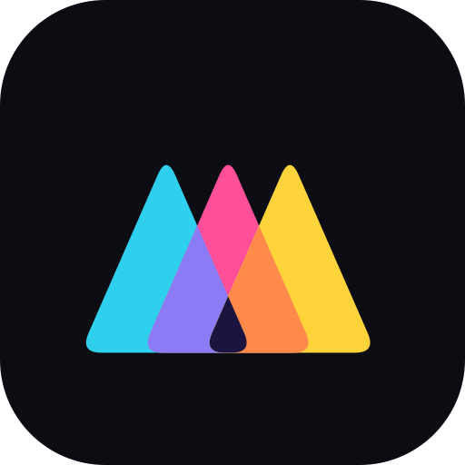

<p align="center">
  
</p>

<h1 align="center">Bravinall</h1>

<p align="center"><b>Trang chủ của hệ sinh thái công cụ sáng tạo do Phạm Việt Hà làm.</b><br>
Thiết kế trong Antifact · mở rộng bằng AI với Micron · làm nhạc với Micow · dựng thành video trong Bravin.</p>

<p align="center"><a href="https://bravinall.vtvcab17.workers.dev/"><b>🌐 Xem trang web</b></a></p>

---

## Hệ sinh thái

| | Ứng dụng | Dùng để | Mở ngay | Mã nguồn |
|---|---|---|---|---|
|  | **Antifact** | Chỉnh ảnh, thiết kế, làm slide camera | [antiface.vtvcab17.workers.dev](https://antiface.vtvcab17.workers.dev/) | [Antiface](https://github.com/vtvcab17-max/Antiface) |
|  | **Bravin** | Dựng video trên web, Android, Windows | [bravin.vtvcab17.workers.dev](https://bravin.vtvcab17.workers.dev/) | [Bravin](https://github.com/vtvcab17-max/Bravin) |
|  | **Micron** | Canvas AI mở, chợ plugin cho Bravin | [micron.vtvcab17.workers.dev](https://micron.vtvcab17.workers.dev/) | [micron](https://github.com/vtvcab17-max/micron) |
|  | **Micow** | Làm nhạc ngay trên máy bạn | [micow.vtvcab17.workers.dev](https://micow.vtvcab17.workers.dev/) ¹ | [Micow](https://github.com/vtvcab17-max/Micow) |

¹ Bản web Micow là giao diện; phần tạo nhạc chạy trên máy nên cần cài Micow trước. Chưa cài thì trang tự hiện hướng dẫn.

## Trong repo này có gì

Website tĩnh: HTML, CSS, JS thuần, **không cần build**.

| Đường dẫn | Nội dung |
|---|---|
| `site/index.html` | Trang chủ: bốn sản phẩm, sơ đồ hệ sinh thái bấm được |
| `site/bravin.html` | Trang Bravin 4.10: video giới thiệu, tính năng (có Phim AI), so sánh, dùng ngay |
| `site/antifact.html` | Trang Antifact 1.1: thử hoà trộn layer, trước/sau, khung, so sánh |
| `site/micron.html` | Trang Micron 1.0: thử quy trình, chợ plugin, so sánh |
| `site/micow.html` | Trang Micow 1.1: tạo bài hát, beat, nhạc CapCut, số đo, tải về |
| `site/micon.html`, `site/_redirects` | Chuyển đường dẫn cũ Micon sang Micron |
| `site/assets/site.css`, `site.js` | Giao diện và tương tác dùng chung (trình phát video HTML, so sánh, tải về) |
| `site/assets/deck.css`, `deck.js` | Kiểu trang trình chiếu: mỗi phần một màn hình, thanh timeline ở đáy |
| `site/assets/brand/` | Logo Bravin, Antifact, Micron, Micow |
| `wrangler.jsonc` | Cấu hình Cloudflare Workers, phát thư mục `site/` |

## Chạy thử trên máy

```bash
cd site
python3 -m http.server 8080
# mở http://localhost:8080
```

## Đưa lên web

Trang chạy trên Cloudflare Workers (static assets), cấu hình ở `wrangler.jsonc`:

```bash
npx wrangler deploy
```

> [!IMPORTANT]
> Mỗi tệp trong `site/` phải **nhỏ hơn 25 MiB**, Cloudflare từ chối tệp lớn hơn.

## Thêm video thật

Đặt tệp MP4 (< 25 MiB) vào `site/media/`, rồi thêm `data-video="media/ten.mp4"` vào thẻ `.promo` của trang tương ứng. Nút **Xem video đầy đủ** sẽ tự hiện.

---

<p align="center">© 2026 Phạm Việt Hà · Bravinall</p>
